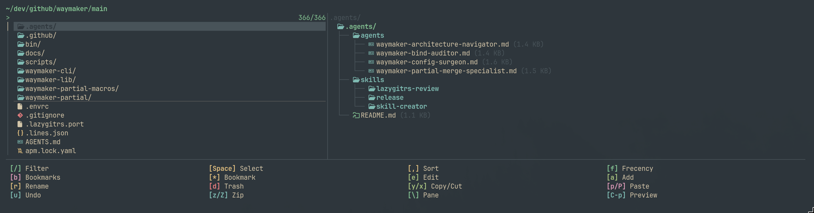

# Waymaker (`wm`)

[](https://github.com/felipecm-br/waymaker/actions/workflows/ci.yml)
[](https://github.com/felipecm-br/waymaker/releases)
[](waymaker-cli/LICENSE)

A terminal fuzzy finder in Rust. Pipe anything into it like fzf, or run it without input to pick files; TOML presets turn it into a directory jumper, a live ripgrep search, a tmux session switcher, a git status picker and more.



## What it does

- **Fuzzy picking** with [nucleo](https://github.com/helix-editor/nucleo) (the Helix matcher): multi-column input, per-column filtering, multi-select, fzf-style binds and actions, `wm -f` for headless filtering.
- **Files without a subprocess**: with no input, an in-process parallel walker lists the current directory (respecting `.gitignore`) and caches it for the next run.
- **Frecency**: directories and items you pick often rank first (`wm add`, `wm list`, `wm init zsh`), with bookmarks.
- **Previews**: syntax-highlighted text, Markdown with Mermaid diagrams, directory trees, and images, video thumbnails and PDFs through Kitty, Sixel or iTerm2 graphics.
- **File operations** in navigation mode: yank, cut, paste, rename, delete to trash, archive, undo.
- **tmux**: a session picker (`wm session`, sesh-compatible config) and popup presets for files, ripgrep, scrollback and key bindings.
- **Presets and layered config**: every option can be set in `config.toml`, a preset (`-o name`) or on the command line (`key=value`), and `wm` warns about keys that have no effect.

## Install

```sh
curl -fsSL https://raw.githubusercontent.com/felipecm-br/waymaker/main/install.sh | sh
```

This installs the `wm` binary to `~/.local/bin` (checked against its published SHA-256) and the default config and presets to `~/.config/waymaker/`. Prebuilt binaries cover Linux (x86_64, aarch64, musl), macOS (Apple Silicon, Intel) and Windows. Options: `--binary-only`, `--configs-only`, `--force` (overwrite configs without `.bak` backups); see `install.sh --help`.

From a clone:

```sh
git clone https://github.com/felipecm-br/waymaker.git && cd waymaker
./install.sh            # or: just install (binary only)
```

## Quick start

```sh
wm                                  # pick a file in the current directory
git branch | wm                     # pick from any input
wm -o jump                          # frecency directory jumper with file operations
wm -o rg                            # live ripgrep with a line-synced preview
wm -f main < files.txt              # headless filter, prints ranked matches
eval "$(wm init zsh)"               # shell integration: tab on an empty line opens jump
```

`esc` steps back (closes an overlay, then clears the query, then quits with status 130); no match exits 1. `F1` shows every bind.

## Presets

Bundled presets run with `wm -o <name>`; `~/.config/waymaker/presets/` holds editable copies.

| Preset | What it is |
| :--- | :--- |
| `jump` | frecency directory navigator and file manager (`l`/`h` in and out, `y`/`x`/`p` yank, cut, paste, `u` undo, `U` ancestors) |
| `workspace` | file browser for code, Markdown and Mermaid, cycling local files, frecency and bookmarks with `tab` |
| `rg` | live ripgrep; `enter` opens the line in `$EDITOR`, `ctrl-s`/`ctrl-w` toggle case and whole word |
| `session-picker` | tmux sessions with pane previews (`wm session`) |
| `tmux/scrollback` | commands, paths, URLs and hashes from a pane's scrollback |
| `tmux/keybindings` | every key bound in the running tmux server; `enter` presses it |
| `ftb` | completion backend for zsh `fzf-tab` |
| `kill` | listening ports and processes; `enter` sends SIGTERM |
| `git/*`, `docker/*`, `kube/*`, `ssh/*` | status, branches, containers, pods, hosts |
| `pr`, `memory`, `man`, `nvim`, `ps`, `csv`, `downloads` | GitHub PRs, agent memory files, man pages, and more |

The tmux presets open in a popup over the current pane; [the tmux preset README](waymaker-cli/assets/presets/tmux/README.md) has a binding for each.

## Documentation

The guide is built into the binary: `wm --doc <page>`.

| Page | Contents |
| :--- | :--- |
| [`features`](waymaker-cli/assets/docs/features.md) | icons, previews, media, colours, spinners, sessions, config layering, the file walker |
| [`options`](waymaker-cli/assets/docs/options.md) | every config key and the `key=value` override syntax |
| [`binds`](waymaker-cli/assets/docs/binds.md) | key syntax, actions, modes, semantic aliases |
| [`template`](waymaker-cli/assets/docs/template.md) | `{}` placeholders and styled templates |
| [`jump`](waymaker-cli/assets/docs/jump.md), [`frecency`](waymaker-cli/assets/docs/frecency.md) | navigation mode and the frecency database |
| [`performance`](waymaker-cli/assets/docs/performance.md) | how the hot paths are built |

`wm --dump-config` prints the effective config; [reference.config.toml](waymaker-cli/assets/reference.config.toml) documents every key. For contributors: [ARCHITECTURE.md](docs/ARCHITECTURE.md) (event flow, where to change what), [BENCHMARKS.md](docs/BENCHMARKS.md) (reproducible numbers against fzf and skim), [CHANGELOG.md](CHANGELOG.md).

## As a library

The picker is the `waymaker-lib` crate (imported as `waymaker`); see [its README](waymaker-lib/README.md) and the [examples](waymaker-lib/examples/).

```rust
use waymaker::nucleo::{Indexed, Worker};
use waymaker::{MatchError, Result, Selector, Waymaker};

#[tokio::main]
async fn main() -> Result<()> {
    let worker = Worker::new_single_column();
    worker.append(["alpha", "beta", "gamma"]);
    let wm = Waymaker::new(worker, Selector::new(Indexed::identifier));
    match wm.pick_default().await {
        Ok(selected) => println!("{}", selected[0]),
        Err(MatchError::Abort(_)) => eprintln!("cancelled"),
        Err(err) => eprintln!("{err}"),
    }
    Ok(())
}
```

## Acknowledgements

Waymaker is developed by [felipecm-br](https://github.com/felipecm-br). It began as a fork of [matchmaker](https://github.com/Squirreljetpack/matchmaker) by Squirreljetpack, which provided the matcher integration, the partial-merge config and the override syntax. It borrows ideas from [fzf](https://github.com/junegunn/fzf), [television](https://github.com/alexpasmantier/television), [zoxide](https://github.com/ajeetdsouza/zoxide), [mcat](https://github.com/Skardyy/mcat), [sesh](https://github.com/joshmedeski/sesh) and [yazi](https://github.com/sxyazi/yazi), and is built on [nucleo](https://github.com/helix-editor/nucleo) and [ratatui](https://github.com/ratatui/ratatui).

## License

[AGPL-3.0-or-later](waymaker-cli/LICENSE).
