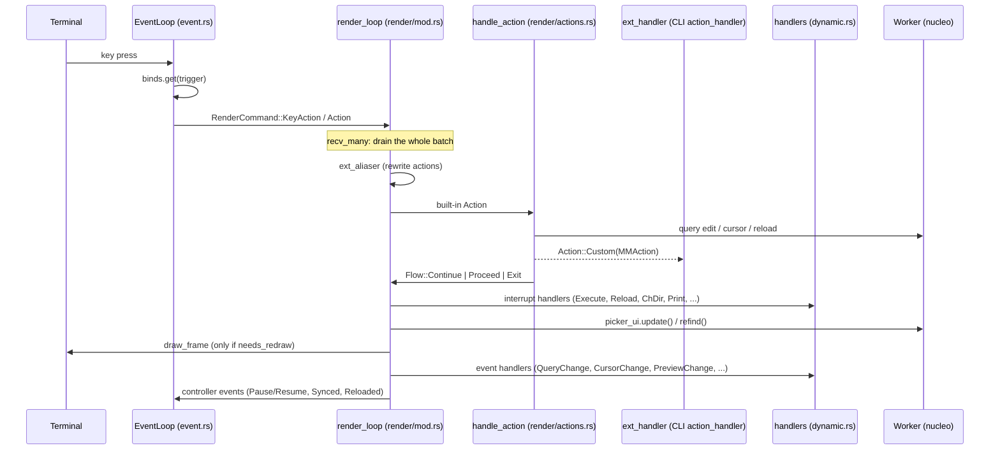

# Architecture

How a keystroke becomes a redrawn screen, and where to change each step. Links point at files; search for the named symbol inside them (line numbers move, names rarely do).

## Crates

| Crate | Role |
| :--- | :--- |
| `waymaker-lib` (imported as `waymaker`) | The picker: matcher, event loop, render loop, previewer, handler registry. Usable on its own as a library. |
| `waymaker-cli` (binary `wm`) | Config loading and layering, presets, the CLI-only actions (`MMAction`: file manager, reload, accept), and the handlers it registers on the library. |
| `waymaker-partial`, `waymaker-partial-macros` | `#[partial]` generates a `PartialConfig` for every config struct, so a user file, a preset and a CLI override each set only the fields they mention and are merged in order. See [waymaker-partial/README.md](../waymaker-partial/README.md). |

## The three tasks

A running picker is three cooperating parts connected by unbounded `tokio::mpsc` channels:

- **Event loop**: `EventLoop::run` in [`waymaker-lib/src/event.rs`](../waymaker-lib/src/event.rs). Reads terminal input (crossterm `EventStream`), ticks, termination signals and controller events; looks keys up in the bind map; sends `RenderCommand`s.
- **Render loop**: `render_loop` in [`waymaker-lib/src/render/mod.rs`](../waymaker-lib/src/render/mod.rs). Owns all UI state. Drains commands in batches, applies actions, runs interrupt and event handlers, draws.
- **Worker**: `Worker` in [`waymaker-lib/src/nucleo/worker.rs`](../waymaker-lib/src/nucleo/worker.rs), wrapping nucleo's matcher threads. Input is pushed through an injector (`WorkerInjector` in [`nucleo/injector.rs`](../waymaker-lib/src/nucleo/injector.rs)) by whichever task reads stdin or the start command (`map_reader_batched` in [`waymaker-cli/src/start/ingest.rs`](../waymaker-cli/src/start/ingest.rs)).

`Matchmaker::pick` in [`waymaker-lib/src/matchmaker.rs`](../waymaker-lib/src/matchmaker.rs) builds these, spawns the event loop, and runs the render loop until it returns the selection.

## One keystroke

### 1. Input to command (`event.rs`)

`EventLoop::run` selects over the tick interval, signals, controller events (`Event`), rebind directives (`BindDirective`) and the terminal stream. A key becomes a `Trigger` and is looked up in the `BindMap`; the bound `Actions` are sent as `RenderCommand::KeyAction`. An unbound printable key becomes `Action::Char`, which types into the query (or into the action box or prompt when one is open). Whether an input box is open, and the current bind mode, live in the picker's `InputState` ([`input_state.rs`](../waymaker-lib/src/input_state.rs)): the event loop creates it, the render loop's `State` holds the same `Arc` as `input_routing`, and while any input box is open every key goes to that box as `Action::Char` instead of being looked up. While the render loop has paused it (for `Execute`), the event loop drops the terminal stream and waits for `Event::Resume`, then replies `RenderCommand::Ack`.

### 2. Batch and dispatch (`render/mod.rs`)

`render_loop` waits on `render_rx.recv_many`, then empties the channel, so one redraw serves every command that arrived together (fast typing, a paste, a burst of reload data). For each command:

- `Resize`, `Mouse` (`handle_mouse` in [`render/mouse.rs`](../waymaker-lib/src/render/mouse.rs)), `Tick`, `ReloadData` and others are handled inline.
- An action goes through the optional `ext_aliaser` first, then `handle_action` in [`render/actions.rs`](../waymaker-lib/src/render/actions.rs). It returns a `Flow`: `Continue` (next command), `Proceed` (check for an interrupt), or `Exit(result)` (return the selection).
- `Action::Custom(a)` carries an extension action and is passed to `ext_handler`. The CLI's is `action_handler` in [`waymaker-cli/src/action/mod.rs`](../waymaker-cli/src/action/mod.rs), which hands `Fm*` actions to [`action/fm.rs`](../waymaker-cli/src/action/fm.rs) and `Reload*` actions to [`action/reload.rs`](../waymaker-cli/src/action/reload.rs).

### 3. Interrupts

An action with effects outside the UI does not perform them; it sets an `Interrupt` on `State` ([`render/state.rs`](../waymaker-lib/src/render/state.rs)) and leaves its payload there. After the action, `render_loop` applies the built-in part (`Execute`: pause the event loop and leave the alternate screen; `Become`: exit the TUI; `Reload`/`ChDir`: mark the matcher unsynced) and then calls every handler registered for that interrupt. The CLI registers its process-spawning handlers in [`waymaker-cli/src/register.rs`](../waymaker-cli/src/register.rs) (`Interrupt::Execute`, `ExecuteSilent`, ...). Its directory handlers (`ChDir`, `Reload`, `Synced`, in [`start/handlers.rs`](../waymaker-cli/src/start/handlers.rs)) and the fm actions share one `NavMemory` per picker: the item to put the cursor on after the next sync, and the item under the cursor when the last reload started. `Reload` refills the list through `Reloader` (pins, frecency directories, the file walker with its caches, or a shell command). This is why `Execute(nvim {})` behaves the same in every embedding: the library only knows that something must run with the terminal released.

### 4. Update and draw

After the batch: `picker_ui.update()` pulls new matches from the worker (or `refind()` after a reload), exit conditions such as `select_1` are checked, a paused TUI is resumed, and `draw_frame` in [`render/frame.rs`](../waymaker-lib/src/render/frame.rs) runs only if something set `needs_redraw` (matcher progress, a changed preview, a resize, a spinner, a blink tick).

### 5. Events

`State::update` compares the new UI state with the previous one and produces an `Event` bitflag (`QueryChange`, `CursorChange`, `PreviewChange`, `Synced`, `Resize`, `Reloaded`, ...; defined in [`message.rs`](../waymaker-lib/src/message.rs)). Each event handler registered with an intersecting mask is called once per matching event, so a handler listening to several events can run more than once per iteration. Most events are then forwarded to the event loop's controller channel.

## Handlers and state

Handlers live in [`render/dynamic.rs`](../waymaker-lib/src/render/dynamic.rs) and are registered on `Matchmaker`:

- `register_event_handler(Event::QueryChange | Event::CursorChange, |state, event| ...)`
- `register_interrupt_handler(Interrupt::Execute, |state| ...)`

Both receive `MMState` ([`render/state.rs`](../waymaker-lib/src/render/state.rs)): mutable access to the query, results, worker, header, footer, preview and config for the duration of the call.

The previewer is one such handler. `make_previewer` in [`matchmaker.rs`](../waymaker-lib/src/matchmaker.rs) registers on `CursorChange | PreviewChange | Resize | Synced`; it reads the preview command from the state, and [`preview/previewer.rs`](../waymaker-lib/src/preview/previewer.rs) runs it in a background task and streams its output into the preview view, discarding results that a newer cursor position has made stale.

## Extending

- **New behaviour on existing events**: register an event or interrupt handler.
- **New actions**: implement `ActionExt` for your enum (the CLI's `MMAction`), pass `PickOptions::ext_handler`, and bind it like any built-in action.
- **Rewriting actions before they run**: `PickOptions::ext_aliaser`. The CLI uses it to resolve `@name` semantic aliases for the current mode and to turn the built-in `Accept` into its own `MMAction::Accept`.

## Configuration flow (CLI)

`enter` in [`waymaker-cli/src/start/mod.rs`](../waymaker-cli/src/start/mod.rs) builds the final `Config` from, in order: the embedded default config, the user's `config.toml`, each `--override`/`-o` preset (and its `source`), path-rule presets, then `key=value` CLI overrides. Every layer is a `PartialConfig` applied with `Apply`; `config::parse_warn` reports keys a layer sets that the schema ignores. Option syntax: [options.md](../waymaker-cli/assets/docs/options.md); binds: [binds.md](../waymaker-cli/assets/docs/binds.md).

## Where to start

| Task | Start in |
| :--- | :--- |
| A key does the wrong thing | `EventLoop` bind lookup in `event.rs`, then `handle_action` |
| A new built-in action | `Action` in [`action.rs`](../waymaker-lib/src/action.rs), `handle_action` |
| A new CLI-only action | `MMAction` and `action_handler` in `waymaker-cli/src/action/` |
| Something must run a process | an `Interrupt` plus a handler in `register.rs` |
| Ranking and sorting | `Worker` in `nucleo/worker.rs` |
| Input parsing and columns | `start/ingest.rs`, `nucleo/injector.rs` |
| Layout and drawing | `render/frame.rs`, `render/draw.rs`, `ui/` |
| Preview behaviour | `preview/previewer.rs`, `make_previewer` |
| Config shape | `waymaker-lib/src/config.rs`, `waymaker-cli/src/config.rs` |
